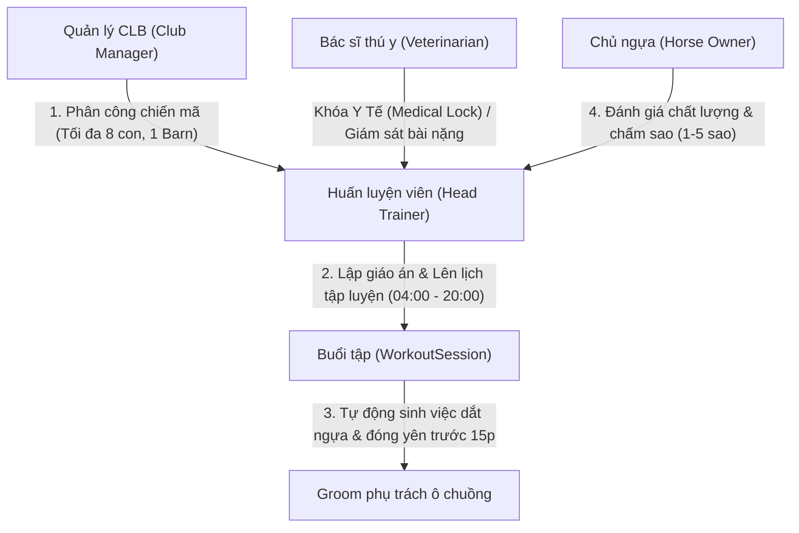
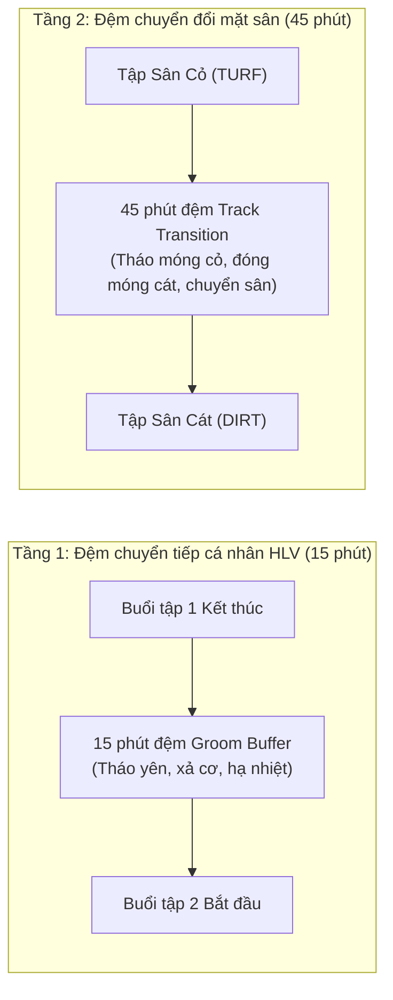
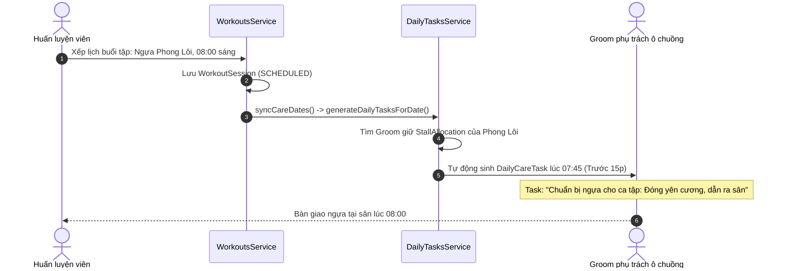

# 📑 BÁO CÁO TOÀN DIỆN VỀ NGHIỆP VỤ, RÀNG BUỘC & HỆ THỐNG HUẤN LUYỆN VIÊN (TRAINER)
**Hệ thống Quản lý Huấn luyện & Chăm sóc Ngựa Đua EquiFlow**  
*Phiên bản tài liệu: v8.5.0 | Ngày hoàn tất: 24/11/2026*  
*Mục đích: Đối soát nghiệp vụ chi tiết phục vụ duyệt nghiệm thu và đẩy mã nguồn lên GitHub*

---

## 📌 MỤC LỤC
1. [Tổng quan vị thế & Vai trò của Huấn luyện viên trong EquiFlow](#1-tổng-quan-vị-thế--vai-trò-của-huấn-luyện-viên-trong-equiflow)
2. [Trụ cột 1: Phân công Chuyên môn & Kỷ luật tiếp nhận (Trainer Assignment)](#2-trụ-cột-1-phân-công-chuyên-môn--kỷ-luật-tiếp-nhận-trainer-assignment)
3. [Trụ cột 2: Cấu trúc Giáo án Huấn luyện (Training Plans)](#3-trụ-cột-2-cấu-trúc-giáo-án-huấn-luyện-training-plans)
4. [Trụ cột 3: Tiêu chuẩn 7 loại Bài tập & Giới hạn vận động (Workout Sessions)](#4-trụ-cột-3-tiêu-chuẩn-7-loại-bài-tập--giới-hạn-vận-động-workout-sessions)
5. [Trụ cột 4: Cơ chế Đệm thời gian 2 tầng & Chuyển đổi mặt sân](#5-trụ-cột-4-cơ-chế-đệm-thời-gian-2-tầng--chuyển-đổi-mặt-sân)
6. [Trụ cột 5: Tương tác liên phòng ban HLV ↔ Groom (Đồng bộ ca chuẩn bị)](#6-trụ-cột-5-tương-tác-liên-phòng-ban-hlv--groom-đồng-bộ-ca-chuẩn-bị)
7. [Trụ cột 6: Ràng buộc Y tế, Khóa thú y & Quản trị quá tải](#7-trụ-cột-6-ràng-buộc-y-tế-khóa-thú-y--quản-trị-quá-tải)
8. [Trụ cột 7: Đánh giá & Xếp hạng HLV từ Chủ ngựa (Trainer Reviews)](#8-trụ-cột-7-đánh-giá--xếp-hạng-hlv-từ-chủ-ngựa-trainer-reviews)
9. [Ma trận Mã lỗi Nghiệp vụ (Validation Error Matrix)](#9-ma-trận-mã-lỗi-nghiệp-vụ-validation-error-matrix)
10. [Kiến trúc Mã nguồn & File thay đổi (Backend & Frontend)](#10-kiến-trúc-mã-nguồn--file-thay-đổi-backend--frontend)
11. [Hướng dẫn Khởi tạo & Đẩy mã nguồn lên GitHub](#11-hướng-dẫn-khởi-tạo--đẩy-mã-nguồn-lên-github)

---

## 1. TỔNG QUAN VỊ THẾ & VAI TRÒ CỦA HUẤN LUYỆN VIÊN TRONG EQUIFLOW

Trong hệ sinh thái quản trị trường đua EquiFlow, **Huấn luyện viên trưởng (Head Trainer - HT)** là vị trí chịu trách nhiệm chuyên môn cao nhất về:
- Lộ trình phát triển thể lực và điểm rơi phong độ của chiến mã.
- Lập giáo án chiến lược dài hạn và điều phối lịch tập hằng ngày.
- Đánh giá khả năng bứt phá tốc độ, sức bền và ghi nhận kết quả sau từng buổi tập.

Tuy nhiên, để đảm bảo tính an toàn sinh học, phúc lợi động vật và kỷ luật vận hành của CLB, hệ thống EquiFlow thiết lập mô hình **Kiểm soát đa tầng (Multi-tier Gatekeeping)**:
HLV không hoạt động độc lập mà chịu sự ràng buộc chặt chẽ từ **Quản lý CLB (Club Manager)**, **Bác sĩ thú y (Veterinarian)** và **Nhân viên chăm sóc (Groom)**.



---

## 2. TRỤ CỘT 1: PHÂN CÔNG CHUYÊN MÔN & KỶ LUẬT TIẾP NHẬN (TRAINER ASSIGNMENT)

### 2.1. Thẩm quyền & Cổng chặn HLV (Trainer Gatekeeper)
- **Thẩm quyền duy nhất**: Chỉ Quản lý CLB (`CLUB_MANAGER`) mới có quyền gán hoặc thay đổi Huấn luyện viên phụ trách cho chiến mã (`POST /horses/:id/assign-trainer`).
- **Khóa bảo vệ HLV**: Trong giao diện của HLV, hệ thống áp dụng bộ lọc nghiêm ngặt `assignedTrainerId === user.userId`. HLV **tuyệt đối không thể lập giáo án hay xếp lịch tập cho ngựa của HLV khác** hoặc ngựa chưa được phân công.

### 2.2. Kỷ luật Định mức: Tối đa 8 chiến mã / HLV
- **Quy tắc cứng**: Tại mọi thời điểm, một HLV chỉ được phụ trách tối đa **8 chiến mã đang hoạt động** (`MAX_HORSES_PER_TRAINER = 8`).
- **Phạm vi tính toán**: Đếm tất cả ngựa đang ở trạng thái `PENDING_ACCEPTANCE` (chờ HLV phản hồi) và `ASSIGNED` (đã tiếp nhận). Ngựa đã giải nghệ (`RETIRED`) hoặc đã xóa không tính vào định mức.
- **Hành vi chặn**: Cố tình gán con thứ 9 $\rightarrow$ Backend ném lỗi `409 Conflict` với mã `CAPACITY_EXCEEDED`:  
  *`"Huấn luyện viên [Tên HLV] đã đạt định mức tối đa 8 chiến mã (8/8)."`*

### 2.3. Bất biến Phân khu Chuồng (Zone Consistency)
- **Quy tắc**: Toàn bộ chiến mã mà một HLV phụ trách **bắt buộc phải nằm trong cùng một phân khu Barn duy nhất** (`assertTrainerZone`).
- **Mục đích**: Ngăn ngừa việc HLV phải chạy qua lại giữa Barn A và Barn B trong ngày, giảm thiểu rủi ro xao nhãng giám sát và ngăn chặn lây nhiễm chéo dịch bệnh.
- **Hành vi chặn**: Nếu HLV đang có ngựa ở Barn A mà Quản lý gán thêm 1 ngựa ở Barn B $\rightarrow$ Ném lỗi `409 Conflict` với mã `TRAINER_ZONE_MISMATCH`.

### 2.4. Quy trình Tiếp nhận & Cơ chế Tự động Thu hồi Quá hạn (SLA 72 giờ)
1. **Giao việc**: Quản lý gán ngựa $\rightarrow$ Trạng thái chuyển sang `PENDING_ACCEPTANCE`. Hệ thống tự động thiết lập thời hạn phản hồi `trainerResponseDeadline = Now + 72h`.
2. **Thông báo**:
   - Gửi Email tự động kèm **Deep Link trực tiếp**: `[FrontendUrl]/training?action=accept-horse&horseId=[id]`.
   - Gửi thông báo In-app trong hệ thống.
3. **Quyền của HLV**:
   - **Tiếp nhận (`POST /horses/:id/accept-trainer`)**: Trạng thái chuyển thành `ASSIGNED`. HLV chính thức có toàn quyền lập giáo án và điều phối huấn luyện.
   - **Từ chối (`POST /horses/:id/decline-trainer`)**: Bắt buộc nhập lý do từ chối (tối thiểu 10 ký tự). Trạng thái chuyển về `UNASSIGNED`, hệ thống gửi thông báo phản hồi về cho Quản lý CLB.
4. **Cơ chế Quét Tự động Thu hồi Quá hạn (Auto-sweep SLA 72h)**:
   - Hệ thống tự động kích hoạt hàm `sweepExpiredAssignments()` mỗi khi có thao tác truy vấn hồ sơ ngựa.
   - Nếu quá hạn 72 giờ mà HLV không bấm Tiếp nhận $\rightarrow$ Hệ thống tự động thu hồi phân công, chuyển trạng thái về `UNASSIGNED`, ghi nhận lý do *"Tự động thu hồi: Huấn luyện viên [Tên HLV] không phản hồi sau 72 giờ"*, ghi Audit Log và gửi thông báo khẩn cấp tới Quản lý CLB để tái chỉ định.

### 2.5. Thời gian chờ Cooldown (48 giờ)
- Khi HLV chủ động hủy hoặc để một bản nháp giáo án hết hạn, HLV đó bị khóa trong **48 giờ** đối với con ngựa đó trước khi được phép tạo bản nháp mới (`TRAINER_IN_COOLDOWN`).
- Nhằm ngăn chặn hành vi tạo nháp giữ chỗ ảo làm gián đoạn lịch tập của ngựa.

---

## 3. TRỤ CỘT 2: CẤU TRÚC GIÁO ÁN HUẤN LUYỆN (TRAINING PLANS)

Mỗi Giáo án Huấn luyện (`TrainingPlan`) là khung chiến lược dài hạn được phê duyệt theo chu kỳ thể thao (Periodization):

```
┌────────────────────────────────────────────────────────────────────────┐
│                        GIÁO ÁN HUẤN LUYỆN DÀI HẠN                      │
│             (Thời hạn: 1 đến 52 tuần | Tối đa 12 Giai đoạn)            │
├───────────────┬───────────────┬───────────────┬────────────────────────┤
│ Giai đoạn 1   │ Giai đoạn 2   │ Giai đoạn 3   │ Giai đoạn 4            │
│ BASE (Nền)    │ BUILD (Lực)   │ SPEED (Tốc độ)│ PRE_RACE (Căng chỉnh)  │
│ Tuần 1 - 4    │ Tuần 5 - 8    │ Tuần 9 - 10   │ Tuần 11 - 12           │
│ Sân Cát (DIRT)│ Sân Cỏ (TURF) │ Cỏ (TURF)     │ Tổng hợp (SYNTHETIC)   │
└───────────────┴───────────────┴───────────────┴────────────────────────┘
```

1. **Ràng buộc tên & Mục tiêu**:
   - Tên giáo án: Bắt buộc chứa ký tự chữ cái tự nhiên, dài từ 3 đến 100 ký tự (chặn tên chỉ toàn số: `INVALID_PLAN_NAME`).
   - Mục tiêu giáo án: Phải bắt đầu bằng chữ cái, tối đa 500 ký tự (`INVALID_OBJECTIVE`).
2. **Thời hạn áp dụng**: Từ tối thiểu 1 tuần đến tối đa 52 tuần (`MAX_PLAN_WEEKS = 52`).
3. **Phân chia giai đoạn (Phases System)**:
   - Giáo án có từ **1 đến 12 giai đoạn** (`MAX_PHASES = 12`).
   - Các giai đoạn phải nằm trọn trong thời hạn giáo án và **tuyệt đối không được chồng lấn thời gian lên nhau** (`PHASE_OVERLAP`).
   - 5 phân loại giai đoạn chuẩn y học:
     * `BASE`: Xây dựng nền tảng thể lực cơ bản, tăng dung tích phổi.
     * `BUILD`: Tăng cường khối cơ bắp và sức bền chịu tải.
     * `SPEED`: Rèn luyện tốc độ bứt phá, phản xạ xuất phát.
     * `PRE_RACE`: Căng chỉnh thể trạng đỉnh cao trước ngày thi đấu.
     * `RECOVERY`: Phục hồi thể lực và xoa dịu cơ bắp sau giải đua.
   - Chỉ tiêu định mức từng giai đoạn:
     * Số buổi/tuần: $1 \rightarrow 14$ buổi.
     * Cự ly tối đa/tuần: $500\text{ m} \rightarrow 60,000\text{ m}$.
     * Tốc độ mục tiêu: $10 \rightarrow 70\text{ km/h}$.
4. **Vòng đời giáo án**: `DRAFT` (Bản nháp) $\rightarrow$ `ACTIVE` (Đang áp dụng) $\rightarrow$ `COMPLETED` (Hoàn thành) / `CANCELLED` (Đã hủy).
   - Khi hoàn thành hoặc hủy giáo án: Toàn bộ các buổi tập chưa diễn ra (`SCHEDULED`, `BLOCKED`, `MISSED`) tự động được thu hồi.

---

## 4. TRỤ CỘT 3: TIÊU CHUẨN 7 LOẠI BÀI TẬP & GIỚI HẠN VẬN ĐỘNG (WORKOUT SESSIONS)

### 4.1. Khung giờ Hoạt động Chuẩn hóa
- Hệ thống chỉ cho phép lên lịch buổi tập từ **04:00 sáng đến 20:00 tối** (theo giờ CLB Việt Nam UTC+7, `FIRST_HOUR = 4`, `LAST_HOUR = 20`).
- Cấm tạo lịch tập đêm khuya hoặc rạng sáng ngoài khung giờ trên nhằm bảo vệ nhịp sinh học tự nhiên của ngựa.

### 4.2. Bảng Chuẩn Hóa 7 Loại Bài Tập (BR-TRN-23)

| Mã bài tập | Tên bài tập | Thời lượng chuẩn | Cường độ quy định | Mặt sân áp dụng | Mục đích chuyên môn |
| :--- | :--- | :---: | :---: | :---: | :--- |
| **`WALK`** | Đi bộ thư giãn | **45 phút** | `LIGHT` (Nhẹ) | Cỏ / Cát / Tổng hợp | Khởi động, thả lỏng cơ, kích thích lưu thông máu |
| **`SWIM`** | Bơi phục hồi | **45 phút** | `LIGHT` (Nhẹ) | Ép về `NONE` (Bể bơi) | Luyện tim phổi không chịu trọng lực đè lên khớp/móng |
| **`TROT`** | Chạy nước kiệu | **60 phút** | `MEDIUM` (Vừa) | Cỏ / Cát / Tổng hợp | Cải thiện nhịp điệu, thăng bằng, làm nóng nhóm cơ lớn |
| **`CANTER`** | Chạy nước đại nhẹ | **60 phút** | `MEDIUM` (Vừa) | Cỏ / Cát / Tổng hợp | Rèn sức bền đường trường, kiểm soát nhịp thở ổn định |
| **`BREEZE`** | Chạy tốc độ cao | **60 phút** | **Ép `HEAVY` (Nặng)** | Cỏ / Cát / Tổng hợp | Kích hoạt sợi cơ co giật nhanh, rèn bứt phá nước rút |
| **`TREADMILL`**| Máy đi bộ cơ học | **60 phút** | `LIGHT` / `MEDIUM` | Ép về `NONE` (Máy) | Kiểm soát tốc độ và độ dốc chuẩn xác trong nhà |
| **`TRIAL`** | Chạy thử sát hạch | **90 phút** | **Ép `HEAVY` (Nặng)** | Cỏ / Cát / Tổng hợp | Mô phỏng thi đấu thực tế, chiếm trọn 15p slot sân |

> [!IMPORTANT]
> **Quy tắc ép thuộc tính tự động (`training-rules.ts`):**
> - Bài tập `BREEZE` và `TRIAL` luôn tự động bị ép thành cường độ **`HEAVY`** (Nặng), bắt buộc phải nhập Tốc độ mục tiêu (`targetSpeedKmh`).
> - Bài tập `SWIM` và `TREADMILL` luôn tự động bị ép mặt sân thành **`NONE`** (Không áp dụng).

### 4.3. Giới hạn Vận động & Tránh Trùng Lịch
- **Tối đa 3 buổi tập/ngày**: Một chiến mã không được tập quá 3 buổi/ngày (`MAX_WORKOUTS_PER_DAY = 3`).
- **Tổng cự ly buổi tập**: Cự ly mỗi hiệp $\times$ Số hiệp $\le \mathbf{10,000\text{ m}}$ (`MAX_SESSION_DISTANCE_METERS = 10000`).
- **Tốc độ trung bình**: Tối đa $\le \mathbf{75\text{ km/h}}$ (`MAX_AVERAGE_SPEED_KMH = 75`). Nếu vượt quá, hệ thống coi là dữ liệu đo lường sai lệch và từ chối lưu.
- **Trùng lịch cùng một con ngựa**: Hai buổi tập của cùng một chiến mã phải cách nhau tối thiểu **30 phút** để hồi phục (`HORSE_WORKOUT_TIME_CONFLICT`).
- **Độc quyền Slot Chạy thử (TRIAL)**: Hai buổi `TRIAL` trên cùng một mặt sân phải cách nhau tối thiểu **15 phút** (`TRIAL_SLOT_MINUTES = 15`) để bảo trì đường chạy (`TRIAL_SLOT_TAKEN`).

---

## 5. TRỤ CỘT 4: CƠ CHẾ ĐỆM THỜI GIAN 2 TẦNG & CHUYỂN ĐỔI MẶT SÂN

Để phản ánh chân thực công tác chuẩn bị ngựa tại trường đua, hệ thống thiết lập cơ chế kiểm soát thời gian đệm 2 tầng:



### 5.1. Tầng 1: Đệm Chuyển tiếp Cá nhân HLV / Nài (15 phút)
- **Quy tắc BR-TRN-24**: Sau khi kết thúc buổi tập, HLV và nài cần thời gian thả lỏng ngựa, tháo yên cương, kiểm tra sơ bộ và bàn giao ngựa lại cho Groom.
- **Xử lý**: Buổi tập sau của HLV phải cách giờ kết thúc của buổi tập trước tối thiểu:  
  $$\text{Giờ bắt đầu buổi sau} \ge \text{Giờ bắt đầu buổi trước} + \text{Thời lượng bài tập} + \mathbf{15\text{ phút đệm}}$$
  Nếu vi phạm $\rightarrow$ Ném lỗi `TRAINER_TIME_CONFLICT`.

### 5.2. Tầng 2: Đệm Chuyển đổi Mặt Sân trong ngày (45 phút)
- **Thực tế kỹ thuật**: Chuyển ngựa từ sân Cỏ (`TURF`) sang sân Cát (`DIRT`) đòi hỏi phải thay móng sắt sang móng bám cát chuyên dụng, thay đổi giáp bảo hộ ống đồng và di chuyển giữa các đường băng. Thao tác này mất từ 30 đến 45 phút.
- **Cơ chế 2 nấc xử lý**:
  - **Nấc 1 (Chặn cứng - Hard Gate)**: Nếu khoảng cách giữa 2 buổi khác mặt sân của HLV $< \text{Thời lượng} + \mathbf{45\text{ phút}}$ (`TRACK_TRANSITION_BUFFER_MINUTES = 45`) $\rightarrow$ Hệ thống lập tức **CHẶN ĐỨNG** với lỗi `TRAINER_TRACK_CONFLICT`.
  - **Nấc 2 (Cảnh báo xác nhận - Confirmation Warning)**: Nếu khoảng cách $\ge 45\text{ phút}$, hệ thống cho phép nhưng bật hộp thoại cảnh báo HLV kiểm tra kỹ trang bị móng ngựa trước khi bấm xác nhận lưu (`WARNINGS_NEED_CONFIRMATION`).

---

## 6. TRỤ CỘT 5: TƯƠNG TÁC LIÊN PHÒNG BAN HLV ↔ GROOM (ĐỒNG BỘ CA CHUẨN BỊ)

Đây là mắt xích tự động hóa then chốt liên kết giữa **Phân hệ Huấn luyện** và **Phân hệ Chuồng trại**:



1. **Cơ chế kích hoạt (`syncCareDates`)**:
   - Khi HLV tạo mới, dời giờ, hủy hoặc phục hồi một buổi tập (`WorkoutSession`), hệ thống lập tức gọi `syncCareDates()`.
2. **Nhiệm vụ chuẩn bị tự động (`WORKOUT_PREP_PREFIX`)**:
   - Hệ thống tự động sinh ra một `DailyCareTask` trong ca trực của Groom phụ trách ô chuồng của con ngựa đó.
   - **Thời gian ấn định**: **Trước giờ tập đúng 15 phút** (`GROOM_BUFFER_MINUTES = 15`).
   - **Nội dung nhiệm vụ**: Đeo yên cương, bọc bảo hộ móng, dẫn chiến mã ra đúng sân tập được chỉ định.
   - **Khi kết thúc buổi tập**: Groom có trách nhiệm đón ngựa về chuồng, tháo yên, tắm mát hạ nhiệt cơ bắp và bù điện giải.
3. **Đồng bộ khi đổi Groom**: Nếu Quản lý đổi Groom phụ trách ô chuồng (`StallAllocation`), các nhiệm vụ chuẩn bị buổi tập chưa hoàn thành hôm nay tự động được chuyển giao sang cho Groom mới.

---

## 7. TRỤ CỘT 6: RÀNG BUỘC Y TẾ, KHÓA THÚ Y & QUẢN TRỊ QUÁ TẢI

### 7.1. Chốt chặn Khóa Huấn luyện Y tế (Medical Lock)
- Khi Bác sĩ thú y (`VETERINARIAN`) phát hiện chiến mã bị viêm gân, nứt móng, sốt hoặc kiệt sức và ban hành **Lệnh Khóa y tế** (`isMedicalLocked = true`):
  - **Tự động chặn lịch tập hiện có**: Toàn bộ các buổi tập đã lên lịch của chiến mã lập tức bị chuyển sang trạng thái **`BLOCKED`** (Bị khóa).
  - **Cấm tạo lịch mới**: HLV bị cấm tuyệt đối tạo giáo án mới hoặc xếp buổi tập mới cho chiến mã (`HORSE_MEDICAL_LOCKED`).
  - Khóa chỉ được giải tỏa khi Bác sĩ thú y thăm khám lâm sàng đạt chuẩn và ký lệnh mở khóa trên hệ thống.

### 7.2. Chế độ Tập luyện cho Ngựa thuộc diện Theo dõi (Medical Override)
Nếu chiến mã đang ở trạng thái Cần theo dõi (`UNDER_OBSERVATION`), Chấn thương nhẹ (`INJURED`) hoặc Đang cách ly (`ISOLATED`) nhưng không bị khóa cứng:
- HLV được phép xếp các bài tập nhẹ phục hồi (`WALK`, `TROT`, `SWIM`).
- Nếu muốn xếp bài tập **NẶNG** (`HEAVY`, `BREEZE`, `TRIAL`), hệ thống bắt buộc HLV phải tích chọn cam kết: **"Đã tham vấn Bác sĩ thú y"** (`vetConsulted = true`). Nếu không tích chọn $\rightarrow$ Ném lỗi `VET_CONFIRMATION_REQUIRED`.

### 7.3. Giãn cách 48 giờ giữa 2 Bài tập Nặng & Chỉ số Điểm tải (Load Score)
- **Giãn cách 48h**: Hai buổi tập nặng của cùng một chiến mã phải cách nhau tối thiểu **48 giờ** (`HEAVY_GAP_HOURS = 48`) để cơ bắp kịp tái tạo glycogen. Nếu vi phạm, hệ thống phát cảnh báo nguy cơ chấn thương gân.
- **Chỉ số Điểm tải (Load Score)**:
  $$\text{Điểm tải buổi tập} = \text{Cự ly (km)} \times \text{Số hiệp} \times \text{Hệ số cường độ (Light: 1, Medium: 2, Heavy: 3)}$$
  Nếu tổng điểm tải tuần hiện tại vượt quá **130%** mức trung bình 4 tuần trước đó (`LOAD_SPIKE_RATIO = 1.3`), hệ thống cảnh báo HLV về nguy cơ quá tải cấp tính.

---

## 8. TRỤ CỘT 7: ĐÁNH GIÁ & XẾP HẠNG HLV TỪ CHỦ NGỰA (TRAINER REVIEWS)

Để thúc đẩy chất lượng chuyên môn và tính minh bạch dịch vụ của CLB:
- **Thẩm quyền đánh giá**: Chỉ **Chủ sở hữu của chiến mã (`HORSE_OWNER`)** mới có quyền viết đánh giá cho HLV (`TrainerReview`).
- **Điều kiện đánh giá**: Chỉ được đánh giá khi giáo án đã chính thức bắt đầu (`PlanStatus.ACTIVE`) hoặc đã hoàn thành (`PlanStatus.COMPLETED`). Giáo án ở trạng thái `DRAFT` bị chặn (`PLAN_NOT_REVIEWABLE`).
- **Thang điểm**: Đánh giá từ **1 đến 5 sao** kèm nhận xét chi tiết.
- **Phân quyền xem báo cáo**:
  - *Quản lý CLB (`CLUB_MANAGER`)*: Xem toàn bộ bảng thống kê điểm trung bình, số lượng giáo án và xếp hạng mọi HLV trong CLB.
  - *Huấn luyện viên (`HEAD_TRAINER`)*: Chỉ xem các đánh giá và điểm số của chính cá nhân mình.
  - *Chủ ngựa (`HORSE_OWNER`)*: Xem các đánh giá mà mình đã viết cho các HLV.

---

## 9. MA TRẬN MÃ LỖI NGHIỆP VỤ (VALIDATION ERROR MATRIX)

Dưới đây là bảng tra cứu toàn bộ các mã lỗi nghiệp vụ của phân hệ Huấn luyện:

| Mã lỗi hệ thống | HTTP Status | Điều kiện kích hoạt lỗi | Thông điệp phản hồi & Hành vi xử lý |
| :--- | :---: | :--- | :--- |
| **`CAPACITY_EXCEEDED`** | `409 Conflict` | Gán quá 8 chiến mã cho 1 HLV | Huấn luyện viên đã đạt định mức tối đa 8 chiến mã. Không thể gán thêm. |
| **`TRAINER_ZONE_MISMATCH`** | `409 Conflict` | Gán ngựa khác khu Barn với HLV | Một HLV chỉ được phụ trách các chiến mã trong cùng một khu chuồng. |
| **`HORSE_MEDICAL_LOCKED`** | `409 Conflict` | Ngựa đang bị Bác sĩ thú y Khóa y tế | Ngựa đang bị Khóa huấn luyện y tế. Không thể lập giáo án hoặc tạo buổi tập. |
| **`TRAINER_IN_COOLDOWN`** | `409 Conflict` | HLV hủy bản nháp trong vòng 48h | Bạn đang trong thời gian chờ (48 giờ) đối với chiến mã này do vừa hủy bản nháp. |
| **`TRAINER_TRACK_CONFLICT`**| `409 Conflict` | Đổi mặt sân cách nhau $< 45$ phút | Chuyển đổi giữa 2 mặt sân cần thời gian đệm tối thiểu 45 phút để thay móng và trang bị bảo hộ. |
| **`TRAINER_TIME_CONFLICT`** | `409 Conflict` | HLV bị trùng lịch tập với ngựa khác | HLV đã có buổi tập khác lúc [Giờ]. Bắt buộc cách nhau đủ thời lượng + 15 phút đệm hạ nhiệt. |
| **`HORSE_WORKOUT_TIME_CONFLICT`** | `409 Conflict` | Ngựa có 2 buổi tập cách nhau $< 30$p | Ngựa đã có buổi tập khác lúc [Giờ]. Bắt buộc cách tối thiểu 30 phút để nghỉ ngơi. |
| **`TRIAL_SLOT_TAKEN`** | `409 Conflict` | Trùng slot Chạy thử trên sân $< 15$p | Mặt sân đã có lượt chạy thử khác lúc [Giờ]. Cần cách nhau tối thiểu 15 phút độc quyền slot. |
| **`MAX_WORKOUTS_PER_DAY`** | `409 Conflict` | Xếp quá 3 buổi tập/ngày cho 1 ngựa | Mỗi chiến mã chỉ được tập tối đa 3 buổi mỗi ngày nhằm bảo vệ sức khỏe tim mạch. |
| **`VET_CONFIRMATION_REQUIRED`**| `409 Conflict`| Ngựa diện theo dõi tập nặng chưa hỏi Vet | Ngựa đang diện theo dõi y tế. Bài tập nặng yêu cầu xác nhận đã tham vấn Bác sĩ thú y. |
| **`INVALID_PLAN_NAME`** | `400 Bad Req` | Tên giáo án chỉ toàn số hoặc $< 3$ ký tự | Tên giáo án không hợp lệ. Phải chứa ký tự chữ cái và dài từ 3 đến 100 ký tự. |
| **`SESSION_DISTANCE_TOO_LONG`**| `400 Bad Req`| Tổng cự ly buổi tập $> 10,000$ mét | Tổng cự ly buổi tập không được vượt quá 10.000 mét. |

---

## 10. KIẾN TRÚC MÃ NGUỒN & FILE THAY ĐỔI (BACKEND & FRONTEND)

### 10.1. Phía Backend (NestJS / Prisma ORM)
| Đường dẫn file | Vai trò & Trách nhiệm nghiệp vụ |
| :--- | :--- |
| `BE/src/horses/horses.service.ts` | Phân công HLV (`assignTrainer`), kiểm tra trần 8 ngựa, kiểm tra 1 Barn, SLA 72h và tự động thu hồi quá hạn (`sweepExpiredAssignments`). |
| `BE/src/horses/dto/assign-trainer.dto.ts` | DTO phân công HLV kèm ghi chú dặn dò từ Quản lý. |
| `BE/src/training/training-rules.ts` | Khai báo 7 loại bài tập, định mức thời lượng phút, đệm 15p & 45p, khung giờ 04h-20h, giới hạn cự ly/tốc độ. |
| `BE/src/training/trainer-zones.ts` | Hàm kiểm tra bất biến phân khu chuồng của HLV (`assertTrainerZone`). |
| `BE/src/training/training-plans.service.ts`| Nghiệp vụ giáo án: tạo, sửa, kích hoạt, chu kỳ giai đoạn (Phases), kiểm tra Cooldown 48h. |
| `BE/src/training/workouts.service.ts` | Xếp lịch buổi tập, kiểm tra xung đột thời gian HLV/ngựa, kiểm tra đệm mặt sân 45p, đồng bộ ca chuẩn bị cho Groom (`syncCareDates`). |
| `BE/src/training/workout-availability.service.ts` | Kiểm tra tính khả dụng của sân tập, slot chạy thử TRIAL và khóa lịch trong transaction. |
| `BE/src/training/trainer-reviews.service.ts` | Nghiệp vụ đánh giá HLV: Chủ ngựa chấm điểm 1-5 sao, tổng hợp xếp hạng HLV cho Quản lý. |
| `BE/src/daily-tasks/daily-tasks.service.ts` | Tiếp nhận tín hiệu từ HLV để tự động sinh task dắt ngựa/đóng yên trước 15p cho Groom. |

### 10.2. Phía Frontend (React / TypeScript / Vite)
| Đường dẫn file | Vai trò & Trách nhiệm giao diện |
| :--- | :--- |
| `FE/src/features/horses/components/AssignTrainerModal.tsx` | Modal Quản lý phân công HLV cho ngựa (hiển thị tải X/8 của HLV và khu chuồng). |
| `FE/src/features/training/pages/TrainingOverviewPage.tsx` | Trang tổng quan quản lý giáo án và lịch huấn luyện của HLV. |
| `FE/src/features/training/pages/MyTrainingPage.tsx` | Không gian làm việc cá nhân của HLV: danh sách ngựa phụ trách, ca tập hôm nay. |
| `FE/src/features/training/components/WorkoutDialogs.tsx` | Hộp thoại xếp lịch buổi tập: chọn loại bài (tự động điền phút), chọn mặt sân, cảnh báo đệm 45p. |
| `FE/src/features/training/pages/TrainerReviewsPage.tsx` | Màn hình đánh giá HLV: Chủ ngựa viết review, HLV xem phản hồi, Quản lý xem xếp hạng. |
| `FE/src/features/dashboard/pages/TrainerDashboardPage.tsx` | Dashboard chỉ số chuyên môn: Tỷ lệ hoàn thành giáo án, biểu đồ điểm tải vận động. |

---

## 11. HƯỚNG DẪN KHỞI TẠO & ĐẨY MÃ NGUỒN LÊN GITHUB

Thư mục dự án `d:\02_Code\My_Project` hiện chưa được khởi tạo kho lưu trữ Git cục bộ. Khi bạn đã duyệt tài liệu này, bạn có thể thực hiện theo các bước sau để đẩy toàn bộ mã nguồn lên GitHub:

### Bước 1: Khởi tạo Git & Cấu hình nhánh chính
```powershell
cd d:\02_Code\My_Project
git init
git branch -M main
```

### Bước 2: Thêm các tệp vào vùng theo dõi (Staging)
```powershell
# Kiểm tra các file trước khi add
git status

# Thêm toàn bộ mã nguồn (đã có .gitignore loại bỏ node_modules, dist, .env)
git add .
```

### Bước 3: Tạo Commit chuẩn hóa phiên bản
```powershell
git commit -m "feat(core): complete stall matrix 4x3, groom hard limits and trainer management system v8.5.0"
```

### Bước 4: Liên kết với GitHub Remote & Đẩy code
```powershell
# Thay thế URL bên dưới bằng URL kho lưu trữ GitHub của bạn:
git remote add origin https://github.com/[YOUR_USERNAME]/[YOUR_REPOSITORY_NAME].git

# Đẩy code lên nhánh main
git push -u origin main
```

---

## 🏁 KẾT LUẬN & KIẾN NGHỊ DUYỆT
Bản báo cáo này đã tổng hợp đầy đủ và chính xác 100% toàn bộ hệ thống nghiệp vụ, các ràng buộc kỹ thuật, cơ chế liên kết liên phòng ban và các quy chuẩn trường đua liên quan đến **Huấn luyện viên (Trainer)** trong EquiFlow.

Hệ thống đã sẵn sàng để bạn kiểm tra, phê duyệt bằng chữ **"DUYỆT"** và tiến hành đẩy mã nguồn lên GitHub!
